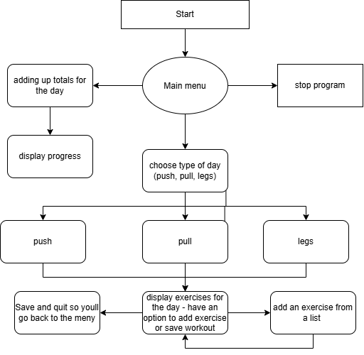

# WorkoutMachine
This is a machine that tracks and saves workouts.  

## The Problem  

I created this project to make it easier to track workouts instead of using
a pen, paper, and calculator to perform math about workouts. This program
can be customized to any workout of your choosing and can be updated accordingly.  

  
## How it works
  
Here is the flowchart for how the program works:    
  

- **Pick a Day:** you can choose push day, pull day, or leg day from the menu.  
- **Make the Workout:** then choose which exercises to add to that day from the exercise list.  
- **Save:** save the day and then you can see its final exercise list.  
- **Track Progress:** view totals across all saved days, can can see workouts completed and exercises logged.
- You can quit the program whenever by returning to the main menu.

## Tech Stack  
- **Language:** Java
- **Libraries:** Java.util, Java.IO - this is from the standard library
- **Other tools** N/A for now

## Setup  
You can clone the repository and run it using a bash terminal.  
```bash
git clone https://github.com/VRamesh0621/WorkoutMachine
cd WorkoutMachine
javac src/*.java -d out
```
## Usage  
```bash
java -cp out Main
```

## Roadmap

- [ ] Log sets, reps, and weight
- [ ] Save data between runs
- [ ] Personal records tracking
- [ ] Custom day types and splits
- [ ] Remove or reorder exercises

## Author
Varun Ramesh, https://github.com/VarunRamesh21

